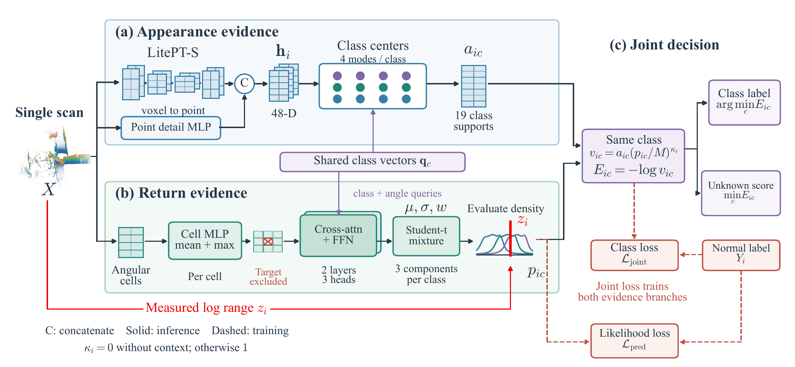

# SERVE

### Semantic Evidence from Return Verification for LiDAR Segmentation

**Jinze Gao · Jie Ma**

SERVE asks whether a semantic class can explain both a LiDAR point's appearance and its measured range. Class-conditioned return prediction joins feature evidence to produce a semantic label and an unknown-object score from one scan.

Full source code is being prepared for release. **Coming soon.**

[Method](#method) · [Selected implementation](#selected-implementation) · [Citation](CITATION.cff)



*The feature branch reads the complete scan. The range branch predicts from neighboring angular cells; the measured target range enters after prediction. The point cloud is a recorded STU scan, and the density curves illustrate the computation. [Vector figure](figures/method.pdf) · [Figure attribution](figures/ATTRIBUTION.md).*

## Method

1. **Appearance evidence.** A point-cloud encoder represents each return using four appearance modes per semantic class.
2. **Return verification.** A class-conditioned predictor estimates a three-component Student-t distribution over log range from neighboring angular cells. Every return in the target cell is excluded before interactions between cells.
3. **Same-class agreement.** Feature support and normalized return density are multiplied within each class. The strongest joint support determines the semantic label; weak support raises the unknown-object score.

The study uses 19 semantic classes, with 28,130 nuScenes scans for source training and 449 normal STU scans for adaptation.

In energy form, adding appearance and return energies implements this product:

$$E_{ic}=E^{\mathrm{appearance}}_{ic}+E^{\mathrm{return}}_{ic}, \qquad \hat{y}_i=\operatorname*{arg\,min}_{c} E_{ic}, \qquad s_i=\min_c E_{ic}.$$

Here, $i$ indexes measured returns, $c$ indexes semantic classes, and $s_i$ is the raw unknown-object score. Return density is normalized by a common Student-t peak bound, preserving class competition and the density's scale penalty.

## Selected implementation

[`evidence.py`](evidence.py) contains the measured-return density calculation, normalized return energy, and same-class readout. The CPU example follows three measured ranges through fixed class densities and prints the resulting labels and raw unknown scores.

```bash
python -m pip install -r requirements.txt --index-url https://download.pytorch.org/whl/cpu
python evidence.py
```

| Function | Computation |
| --- | --- |
| `return_density` | Evaluate a class-conditioned Student-t mixture at measured log range |
| `geometry_energy` | Convert mixture density to normalized return energy |
| `same_class_readout` | Combine evidence for the same class and read out labels and raw scores |

The example uses three illustrative classes. The computation accepts tensors with an arbitrary number of classes and mixture components. A return without neighboring context receives zero return energy, preserving its appearance evidence.

## Acknowledgments and citation

SERVE builds on [LitePT](https://github.com/prs-eth/LitePT) for point-cloud features and uses [STU](https://github.com/kumuji/stu_dataset) for unknown-object evaluation. The method figure includes a measured STU point cloud; its source and design references are documented in the [figure attribution](figures/ATTRIBUTION.md).

The selected implementation is available under the [MIT License](LICENSE). Citation metadata is provided in [CITATION.cff](CITATION.cff).
